<p align="center">
  
</p>

<h1 align="center">Bébène</h1>

<p align="center">
  <b>Un chat noir en pixel art qui vit sur ton bureau Windows et qui te répond grâce à Claude Code.</b><br>
  Il marche, dort, fait sa toilette, chasse ta souris… et quand tu cliques dessus, il ouvre une discussion
  capable de répondre à tes questions <i>et</i> d'agir sur ton PC : fichiers, Excel, Word, dossiers, programmes.
</p>

<p align="center">
  <a href="https://github.com/P0770/bebene/actions/workflows/ci.yml"></a>
  <a href="https://buymeacoffee.com/p0770"></a>
</p>

<p align="center">
  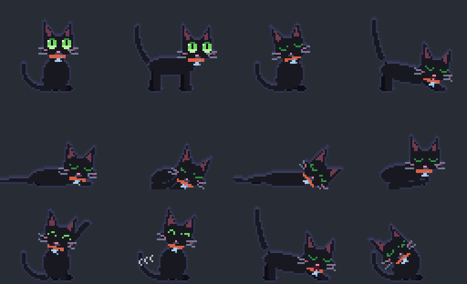
</p>

---

## Sommaire

1. [En bref](#en-bref)
2. [Ce que Bébène sait faire](#ce-que-bébène-sait-faire)
   - [La discussion](#1-la-discussion)
   - [Agir sur ton PC](#2-agir-sur-ton-pc)
   - [Calendrier, examens et rendez-vous](#3-calendrier-examens-et-rendez-vous)
   - [Correcteur d'orthographe](#4-correcteur-dorthographe)
   - [Le chat de bureau](#5-le-chat-de-bureau)
   - [Réglages et assistant d'installation](#6-réglages-et-assistant-dinstallation)
3. [Installation](#installation)
4. [Utilisation au quotidien](#utilisation-au-quotidien)
5. [Sécurité et vie privée](#sécurité-et-vie-privée)
6. [Faire évoluer Bébène et publier une nouvelle version](#faire-évoluer-bébène-et-publier-une-nouvelle-version)
7. [Structure du dépôt](#structure-du-dépôt)
8. [Questions fréquentes](#questions-fréquentes)

Documentation détaillée : [Architecture technique](docs/ARCHITECTURE.md) · [Publier une mise à jour](docs/MISE-A-JOUR.md) · [Modifier ou contribuer](CONTRIBUTING.md)

---

## En bref

| | |
|---|---|
| **Plateforme** | Windows 10 / 11 |
| **Cerveau** | [Claude Code](https://claude.com/claude-code) (`claude -p`), avec ton compte Claude Pro ou Max : aucune clé d'API |
| **Technologie** | C# (WinForms, .NET Framework 4, aucun SDK à installer) + WebView2 pour l'interface de discussion |
| **Mémoire** | partagée avec Claude Code via le dossier **ClaudeHub** sur OneDrive (préférences, journal, projets) |
| **Coût en tokens** | seulement quand tu discutes : calendrier, mails, correcteur et animations sont 100 % locaux |

---

## Ce que Bébène sait faire

### 1. La discussion

Clic sur le chat, **Alt + Espace** ou **Ctrl + Alt + C** (raccourcis modifiables dans Réglages > Système) : la discussion s'ouvre juste au-dessus de Bébène. La réponse s'écrit **en direct**, mot par mot, pendant que Claude la rédige.

<p align="center">
  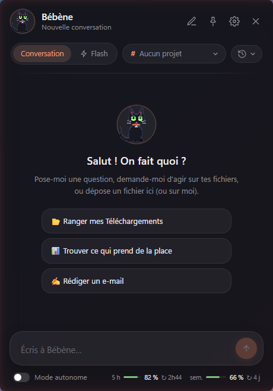
  &nbsp;
  
</p>

**L'en-tête**
- l'avatar de Bébène (il pulse quand Claude réfléchit), son nom et en dessous le titre de la conversation ;
- ☕ **offrir un café** (ouvre la page [Buy Me a Coffee](https://buymeacoffee.com/p0770)) · ✏️ **nouvelle conversation** · 📌 **épingler** (la fenêtre reste ouverte quand tu cliques ailleurs) · ⚙️ **réglages** · ✕ **fermer** (ou Échap) ;
- **glisse l'en-tête** pour déplacer la fenêtre : elle revient à sa place à la fermeture, sauf si elle est épinglée.

**La barre de choix**, juste en dessous :

| Élément | Rôle |
|---|---|
| **Conversation \| ⚡ Flash** | interrupteur. *Conversation* = enregistrée dans l'historique. *Flash* = question rapide qui n'est enregistrée **nulle part** (ni historique, ni archive, et la transcription de Claude Code est effacée). |
| **# Projet ▾** | travailler dans un projet ClaudeHub : Claude travaille dans `ClaudeHub/projets/<nom>/` et la conversation y est **archivée automatiquement**. On peut créer un projet directement depuis le menu, ou choisir n'importe quel autre dossier. |
| **🕘 Historique ▾** | l'historique **du contexte en cours** : dans un projet, uniquement les conversations de ce projet ; sans projet, uniquement les conversations sans projet. × pour en supprimer une, « Continuer dans le terminal » pour reprendre la conversation dans Claude Code. |

<p align="center">
  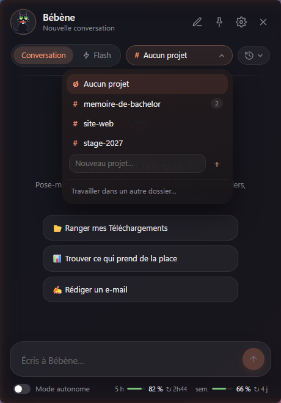
  &nbsp;
  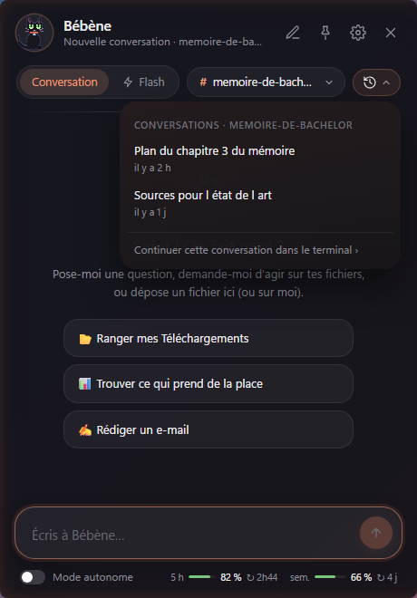
</p>

> Un **projet** rassemble toutes les conversations d'un même sujet. Le menu **#** affiche combien de conversations chaque projet contient ; une fois dans un projet, l'historique ne montre que les siennes.

**Le mode Flash** change la couleur de la zone de saisie (pointillés dorés) pour qu'on ne l'oublie pas :

<p align="center">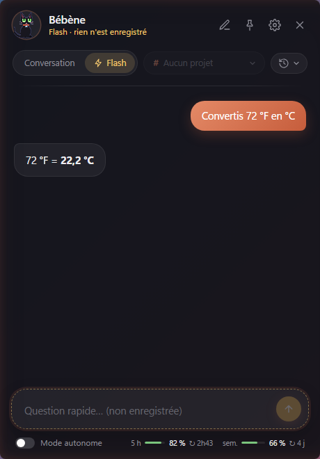</p>

**Le pied de la fenêtre**
- **Mode autonome** : désactivé, Claude modifie les fichiers mais **te demande avant chaque commande** ; activé, il agit sans demander.
- **Quota restant** : ce qu'il te reste sur ta limite de **5 heures** et sur la **semaine**, avec le compte à rebours jusqu'à la recharge (`↻ 2h44`, `↻ 4 j`). La barre passe du vert au jaune puis au rouge. Les chiffres viennent directement de Claude Code (événement `rate_limit_event`), mesurés à l'ouverture, toutes les 15 minutes et à chaque réponse.

**Écrire des listes** : commence une ligne par `1.` ou `*` (ou `-`) suivi d'un espace : **Entrée** passe à l'élément suivant (`2.`, `3.`… ou `•`), Entrée sur un élément vide termine la liste. **Ctrl + Entrée** envoie à tout moment, **Maj + Entrée** fait un simple retour à la ligne.

<p align="center">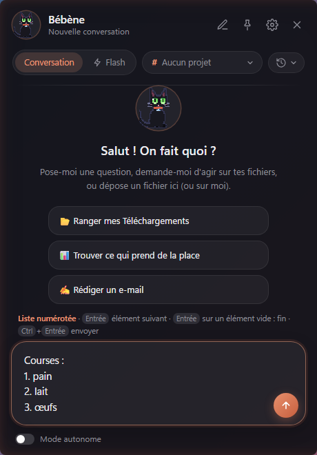</p>

**Titres résumés** : le titre de chaque conversation dans l'historique est rédigé par Claude (modèle Haiku, quelques tokens) pour résumer ce qui s'y est dit ; il est revu au fil de la conversation.

**Compactage automatique** : quand une conversation devient longue (environ 40 000 tokens de plus qu'au début), Bébène en résume le début avec le modèle Haiku. Chaque message suivant renvoie alors beaucoup moins de tokens à Claude ; une petite note « ♻ Conversation compactée : 68k → 12k tokens » l'indique dans la conversation.

**Copier** : chaque bloc de code a une barre avec son langage et un bouton **Copier** ; survole n'importe quel message (le tien ou celui de Bébène) pour faire apparaître un petit bouton qui le copie en entier, au format d'origine (Markdown).

<p align="center">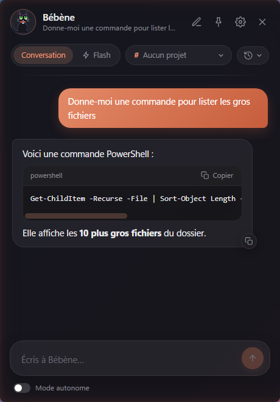</p>

**Glisser-déposer** : dépose un ou plusieurs fichiers sur la discussion *ou directement sur le chat* : leurs chemins sont ajoutés à ton message.

**Quand tu fermes la discussion pendant que Claude réfléchit**, Bébène garde son animation de réflexion (petites bulles, queue qui s'agite). Quand la réponse est prête, il devient **content** : yeux plissés, bulle « ! », petits sauts avec un cœur, et il attend comme ça jusqu'à ce que tu rouvres la discussion, même si tu le prends par la peau du cou entre-temps.

<p align="center"></p>

### 2. Agir sur ton PC

Bébène n'est pas qu'un chat qui parle : c'est **Claude Code**, avec accès à tes fichiers et à tes programmes.

- **Fichiers et dossiers** : ranger, renommer, chercher, résumer, comparer, convertir.
- **Office et autres programmes** : Excel, Word, PowerPoint, Outlook, Inventor… Bébène agit **dans le fichier ouvert devant toi** (pilotage COM, ligne de commande ou UI Automation, via la skill `piloter-applis`).
- **Fenêtre active** : Bébène sait quelle fenêtre tu utilisais juste avant de lui écrire. « Corrige le document ouvert » suffit.
- **Autorisations** : avant une commande, une carte te demande ton accord. « Autoriser » vaut pour toute la conversation. Dans les réglages, tu peux autoriser certains outils une fois pour toutes.

<p align="center"></p>

Exemples :
> « Mets les graphiques du fichier ouvert en échelle logarithmique »
> « Trouve ce qui prend de la place dans mon dossier Documents »
> « Rédige un mail pour décaler mon rendez-vous de jeudi »

### 3. Calendrier, examens et rendez-vous

Deux **doubles flèches orange** encadrent la discussion :
- **«** à gauche : le **calendrier du mois** (points de couleur = événements, point rouge = examen). Clic sur un jour pour voir le détail.
- **»** à droite : deux listes séparées, **Examens** et **Rendez-vous**, avec le compte à rebours (« aujourd'hui », « dans 4 j »).

<p align="center">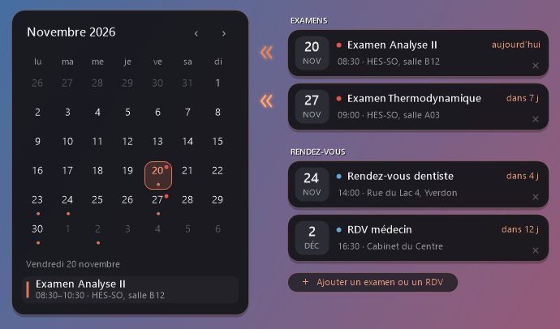</p>

D'où viennent les événements :
- **tes calendriers** : liens `webcal://`, `https://…ics` ou fichiers `.ics` (Google Agenda, Outlook, horaire de l'école…), répétitions (`RRULE`) comprises ;
- **tes mails des 6 derniers mois** : Gmail (mot de passe d'application, chiffré sur ton PC) et Outlook classique. Bébène y repère les convocations d'examen et les rendez-vous (date, heure, lieu), **sur ton PC, sans token** ;
- **à la main** : bouton « ＋ Ajouter un examen ou un RDV », et × sur une carte pour la retirer.

Les volets sont **transparents** (seules les cartes sont dessinées) et **déplaçables** : glisse-les où tu veux, ils reviennent à leur place à la fermeture.

**Rappels** : une carte apparaît au-dessus du chat la veille à 18 h et 1 h avant (réglable séparément pour examens et rendez-vous). Boutons *OK* et *Ne plus me rappeler*.

<p align="center">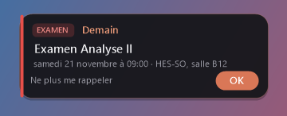</p>

### 4. Correcteur d'orthographe

Partout où tu écris (navigateur, Word, Bloc-notes, Teams…), quand tu fais une pause, **une petite croix rouge** apparaît sur chaque faute. Clic dessus : les suggestions s'affichent, et Bébène tape la correction à ta place.
- correcteur intégré de Windows (français de Suisse), **100 % local, 0 token** ;
- seulement les fautes d'orthographe, seulement le texte que tu es en train d'écrire ;
- jamais dans les champs de mot de passe, les terminaux ou les gestionnaires de mots de passe.

### 5. Le chat de bureau

Bébène est dessiné **procéduralement** (aucune image : chaque pose est calculée), en pixel art 8 bits.

- il **marche, court, s'assoit, fait sa toilette** (visage et corps), **s'étire en bâillant**, **se gratte** derrière l'oreille, **se frotte en ronronnant** ;
- il **dort** dans 4 positions (allongé, enroulé, étalé, en pain) quand tu laisses le PC tranquille ;
- il **chasse ta souris** de temps en temps ;
- **caresse-le** (survole-le) : il ferme les yeux, ronronne (petites ondes) et envoie un cœur ;
- **attrape-le par la peau du cou** : il se balance comme un pendule, à l'opposé de ton geste, puis retombe quand tu le lâches.

<p align="center"></p>

Détails : yeux verts, oreilles légèrement asymétriques, collier orange avec un petit poisson, queue physique avec inertie.

### 6. Réglages et assistant d'installation

Clic droit sur l'icône de Bébène (zone de notification) → **Réglages…**, ou ⚙️ dans la discussion.

<p align="center">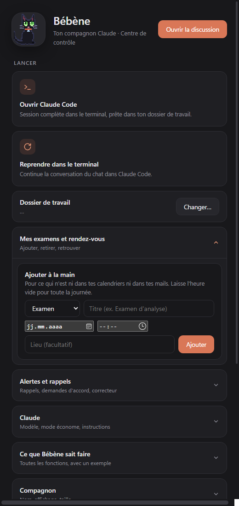</p>

Les sections, de la plus utilisée à la moins utilisée :

| Section | Contenu |
|---|---|
| **Lancer** | ouvrir Claude Code, reprendre la conversation dans le terminal, dossier de travail |
| **Mes examens et rendez-vous** | ajouter à la main, retrouver ceux qu'on a retirés |
| **Alertes et rappels** | rappels examens / RDV, outils autorisés sans demande, correcteur |
| **Claude** | modèle (Opus, Sonnet, Haiku), mode économe *Caveman*, écriture en direct, instructions personnalisées |
| **Ce que Bébène sait faire** | le catalogue de toutes les fonctions avec un exemple, et un badge « Nouveau » |
| **Compagnon** | nom, taille, afficher le chat, toujours au premier plan |
| **Calendriers** | liens webcal / .ics, filtre de lieu |
| **Boîtes mail** | Gmail et Outlook classique |
| **Assistant d'installation** | checklist interactive (voir ci-dessous) |
| **Système** | correcteur, démarrage avec Windows, raccourcis clavier, version |

**L'assistant d'installation** vérifie et fait chaque étape à ta place : Claude Code installé, compte connecté, mémoire ClaudeHub, outils (RTK, Caveman), raccourci du menu Démarrer, démarrage avec Windows… Il s'ouvre tout seul quand Bébène est lancé sur un PC pas encore prêt.

---

## Mises à jour

Une **pastille sur l'avatar** de Bébène, en haut à gauche de la discussion, indique l'état :

| Pastille | Signification |
|---|---|
| 🟠 orange, qui pulse | une version plus récente est publiée dans les [Releases](../../releases) |
| 🟢 verte | la dernière mise à jour s'est bien installée |

<p align="center">
  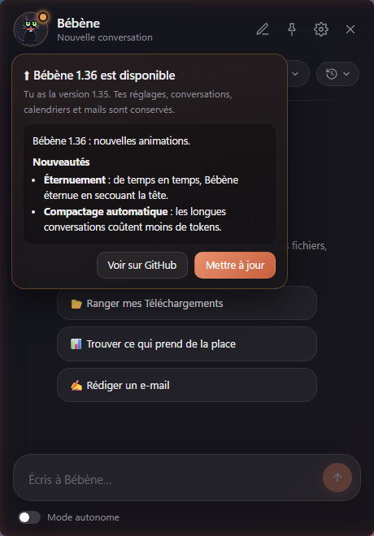
  &nbsp;
  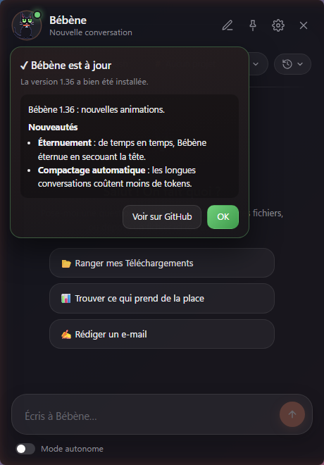
</p>

Survole-la pour le détail, clique pour voir les nouveautés et **Mettre à jour**. Bébène télécharge le zip de la Release, se ferme, remplace **uniquement son programme** (exe, DLL, pages) et redémarre. Les réglages (registre), les conversations, les calendriers, les mails et le journal sont ailleurs et ne sont pas touchés.

La vérification se fait 15 secondes après le démarrage, puis toutes les 6 heures et à l'ouverture de la discussion. Elle compare le numéro de version installé avec celui de la dernière Release GitHub. Tant que le dépôt est privé, elle passe par GitHub CLI (`gh`) connecté sur le PC.

---

## Installation

### Depuis une version publiée (recommandé)

1. Va dans **[Releases](../../releases)** et télécharge le dernier `Bebene-<version>-<date>.zip`.
2. Dézippe-le où tu veux (Bureau, Téléchargements…).
3. Double-clique sur **`ClaudeCompanion.exe`**.
4. L'**assistant d'installation** s'ouvre : suis les étapes dans l'ordre. Chaque bouton fait le travail pour toi.

Il faut : Windows 10 ou 11, une connexion internet et un compte Claude **Pro ou Max**.
Si Windows affiche « Windows a protégé votre ordinateur » : *Informations complémentaires* → *Exécuter quand même*.

### Depuis le code source

```powershell
git clone https://github.com/P0770/bebene.git
cd bebene
.\build.ps1 -Install
```

`build.ps1` compile avec le `csc.exe` déjà présent dans Windows (.NET Framework 4), ne télécharge rien d’autre que les DLL WebView2 (NuGet, une seule fois), installe l'app dans `%USERPROFILE%\ClaudeCompanion` et la relance. `-Install` ajoute aussi le raccourci du menu Démarrer et le démarrage avec Windows.

---

## Utilisation au quotidien

| Action | Comment |
|---|---|
| Ouvrir / fermer la discussion | clic sur le chat, **Alt + Espace**, **Ctrl + Alt + C** (modifiables), Échap pour fermer |
| Nouvelle conversation | ✏️ dans l'en-tête, ou clic droit sur l'icône → *Nouvelle conversation* |
| Question rapide sans trace | interrupteur **⚡ Flash** |
| Travailler sur un projet | **# Projet ▾** → choisir ou créer |
| Reprendre une ancienne conversation | **🕘 ▾** |
| Gros travail | *Continuer dans le terminal* (même conversation dans Claude Code) |
| Joindre un fichier | glisser-déposer sur la discussion ou sur le chat |
| Garder la fenêtre ouverte | 📌 |
| Déplacer une fenêtre | glisser son en-tête (discussion) ou la carte (calendrier, examens) |
| Calendrier / examens | doubles flèches **«** et **»** de chaque côté de la discussion |
| Quitter | clic droit sur l'icône → *Quitter* |

Menu de l'icône (zone de notification) : *Ouvrir la discussion*, *Nouvelle conversation*, *Ouvrir Claude Code ici*, *Correcteur d'orthographe*, *Afficher le chat sur le bureau*, *Réglages…*, *Quitter*.

---

## Sécurité et vie privée

- **Verrou anti auto-modification** : depuis ses conversations, Bébène **ne peut pas modifier son propre programme**, ses réglages ou ses données, même en mode autonome. Un *hook* Claude Code (`garde.ps1`) bloque toute écriture ou commande qui vise son dossier. Son évolution se fait uniquement avec Claude Code dans le terminal.
- **Mails** : lus et analysés **localement**. Le mot de passe d'application Gmail est chiffré avec DPAPI (lisible seulement par ton compte Windows). Rien n'est envoyé à Claude.
- **Calendriers et correcteur** : entièrement locaux.
- **Mode Flash** : aucune trace, même la transcription locale de Claude Code est supprimée.
- **Réglages** : dans le registre (`HKCU\Software\ClaudeCompanion`). **Journal** : `%LOCALAPPDATA%\ClaudeCompanion\bebene.log`.

---

## Faire évoluer Bébène et publier une nouvelle version

En résumé : **modifier → tester → double-clic sur `Publier sur GitHub.cmd`**.

1. Fais tes modifications avec Claude Code dans ce dossier (Bébène ne peut pas se modifier lui-même).
2. Teste : `.\build.ps1` compile et relance l'app.
3. Pour une **nouvelle version téléchargeable**, augmente le numéro dans `Companion.cs` (`Version` **et** `AssemblyVersion`) et ajoute les nouveautés dans `fonctions.json` avec `"depuis": "<nouvelle version>"`.
4. Double-clic sur **`Publier sur GitHub.cmd`** : il compile, te demande une phrase de description, envoie le code, puis crée la *Release* GitHub avec le zip et les notes de version (tirées de `fonctions.json`).

Tout est expliqué pas à pas dans **[docs/MISE-A-JOUR.md](docs/MISE-A-JOUR.md)**.

---

## Structure du dépôt

```
bebene/
├── Companion.cs                 démarrage, réglages, le chat animé (+ Version de l'app)
├── Discussion.cs                fenêtre de discussion, tâches Claude en parallèle
├── PostIts.cs · Agenda.cs       post-it · calendriers, mails, rappels
├── Correcteur.cs · Modeles.cs   correcteur d'orthographe · modèles de référence
├── Installation.cs · Reglages.cs  assistant d'installation, mises à jour · fenêtre des réglages
├── tests/tests.ps1              tous les tests (images, gardien, pages ; -Claude : tâches réelles)
├── ui.html                      page de la discussion (WebView2)
├── settings.html                page des réglages et assistant d'installation
├── fonctions.json               catalogue des fonctions (affiché dans les réglages + notes de version)
├── build.ps1                    compilation, icône, installation
├── creer-paquet.ps1             crée le zip à partager           ← « Créer le paquet Bébène.cmd »
├── publier-version.ps1          publie sur GitHub (code + release) ← « Publier sur GitHub.cmd » (propriétaire uniquement)
├── CONTRIBUTING.md              utiliser, modifier, proposer des changements
├── assets/
│   ├── icone-bebene.png         icône source (pixel art 32×32)
│   └── make-icon.ps1            générateur de l'icône
├── docs/
│   ├── ARCHITECTURE.md          fonctionnement interne
│   ├── MISE-A-JOUR.md           publier une nouvelle version
│   └── images/                  captures du README (générées par les modes de test)
└── NOTES.md                     journal de développement, version par version
```

---

## Modifier Bébène ou proposer des changements

Tout le monde peut télécharger Bébène, copier le code (fork) et le modifier chez soi. **Seul le propriétaire publie les versions officielles** : GitHub refuse toute écriture d'une autre personne, et le script de publication le vérifie aussi. Les propositions passent par une *pull request*. Détails : [CONTRIBUTING.md](CONTRIBUTING.md).

---

## Questions fréquentes

**Bébène consomme-t-il mes tokens en permanence ?**
Non. Seule la discussion utilise Claude. La mesure du quota fait une mini-requête (modèle Haiku, quelques tokens) à l'ouverture et toutes les 15 minutes quand la fenêtre est visible.

**Le quota affiché est-il fiable ?**
Oui, ce sont les chiffres officiels renvoyés par Claude Code. Le compte à rebours avance en continu, et quand la fenêtre de 5 h est écoulée, Bébène refait une mesure.

**Outlook ne fonctionne pas ?**
Le *nouvel* Outlook ne permet pas aux autres programmes de lire les mails. Ouvre une fois **Outlook (classic)** et ajoutes-y ton compte.

**Le chat a disparu ?**
Clic droit sur l'icône → *Afficher le chat sur le bureau*.

**Une mise à jour efface-t-elle mes réglages ou mes conversations ?**
Non. Elle ne remplace que le programme (exe, DLL, pages). Réglages, conversations, calendriers, mails et mémoire sont rangés ailleurs.

**La pastille de mise à jour n'apparaît jamais ?**
Il faut une connexion internet et une Release plus récente que ta version. Si le dépôt est privé, il faut aussi GitHub CLI (`gh`) connecté à un compte qui y a accès.

**Le PC n'a pas WebView2 ?**
Bébène le détecte au démarrage et propose de l'installer (gratuit, Microsoft). Il est déjà présent sur Windows 11 et la plupart des Windows 10.

**Où regarder si quelque chose plante ?**
`%LOCALAPPDATA%\ClaudeCompanion\bebene.log`. Un chien de garde y écrit aussi la pile d'appels si l'interface se fige plus de 3 secondes.

---

<p align="center"><sub>Fait avec Claude Code · 🐈‍⬛ · Bébène te plaît ? <a href="https://buymeacoffee.com/p0770">Offre-moi un café ☕</a></sub></p>
