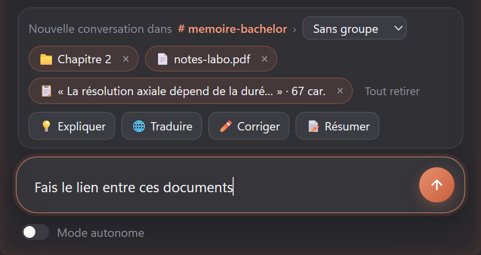
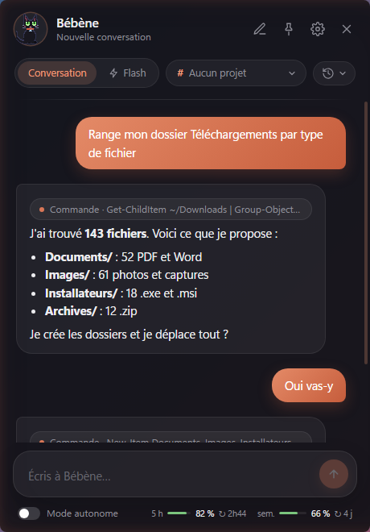
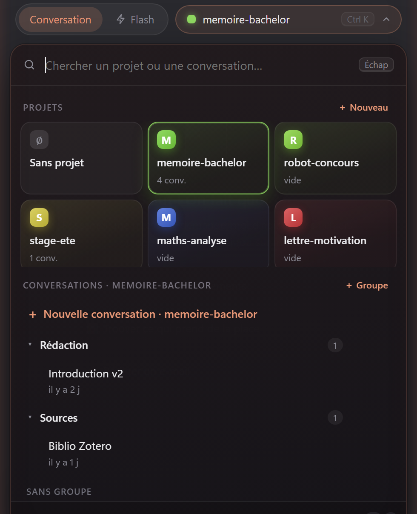
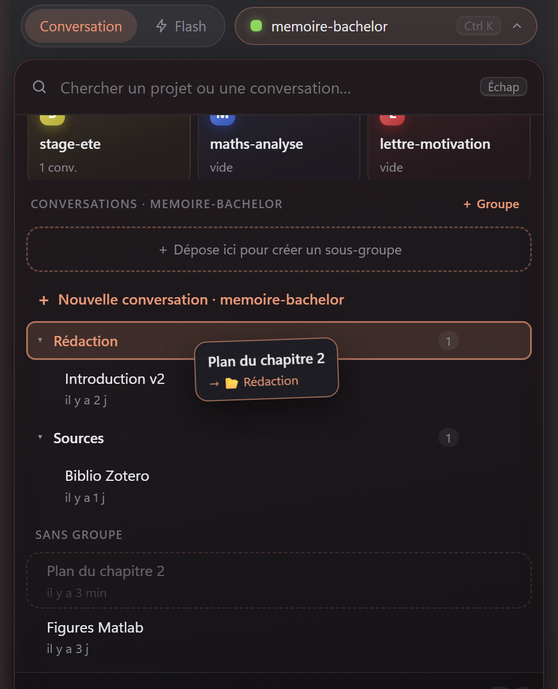
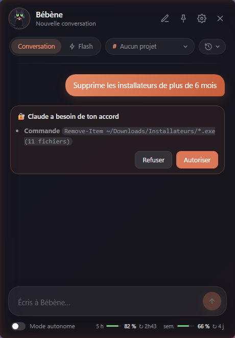

<p align="center">
  
</p>

<h1 align="center">Bébène</h1>

<p align="center">
  <b>Un chat noir en pixel art qui vit sur ton bureau Windows et te répond grâce à Claude Code.</b><br>
  Clique dessus : il ouvre une discussion qui répond à tes questions <i>et</i> agit sur ton PC (fichiers, Excel, Word, programmes).
</p>

<p align="center">
  <a href="https://github.com/P0770/bebene/releases/latest"></a>
  <a href="https://github.com/P0770/bebene/actions/workflows/bebene.yml"></a>
  <a href="https://buymeacoffee.com/p0770"></a>
</p>

<p align="center">
  
</p>

---

## En bref

- **Un assistant toujours à portée de main** : un raccourci (Alt + Espace) ou un clic sur le chat, et tu poses ta question.
- **Il agit vraiment** : c'est Claude Code, avec accès à tes fichiers et à tes programmes, et il te demande ton accord avant chaque commande.
- **Il t'organise** : projets, calendrier, examens et rendez-vous, rappels, post-it.
- **Il reste léger** : environ 0,1 % du processeur au repos ; calendrier et mails fonctionnent en local, sans consommer de tokens.
- **Il répond vite** : effort de réflexion réglable, documents lus intelligemment (texte avant images), travail regroupé.

Il faut Windows 10 ou 11 et un abonnement Claude **Pro ou Max** (aucune clé d'API).

**Sommaire** : [Installer](#installer) · [Au quotidien](#au-quotidien) · [Ce qu'il sait faire](#ce-quil-sait-faire) · [Réglages](#réglages) · [Vie privée et sécurité](#vie-privée-et-sécurité) · [Mises à jour](#mises-à-jour) · [Questions fréquentes](#questions-fréquentes) · [Pour les développeurs](#pour-les-développeurs)

---

## Installer

1. Télécharge le dernier `Bebene-<version>.zip` dans les **[Releases](../../releases/latest)**.
2. Dézippe-le, puis double-clique sur **`ClaudeCompanion.exe`**.
3. L'**assistant d'installation** s'ouvre : suis les étapes, chaque bouton fait le travail pour toi (Claude Code, connexion au compte, mémoire, démarrage avec Windows…).

Si Windows affiche « Windows a protégé votre ordinateur » : *Informations complémentaires* → *Exécuter quand même*.

---

## Au quotidien

### Ouvrir Bébène

Un seul raccourci, **Alt + Espace** (modifiable), ou un clic sur le chat. Depuis Bébène, le même raccourci referme la discussion ; Échap aussi, comme un clic ailleurs.

**Avec une sélection**, c'est encore plus pratique : sélectionne des fichiers ou des dossiers dans l'Explorateur ou sur le Bureau, puis Alt + Espace. Bébène ouvre une nouvelle conversation avec ta sélection en petites étiquettes. Chaque raccourci suivant **ajoute** la nouvelle sélection, et rien n'est perdu si tu fermes la fenêtre avant d'envoyer. Dans les autres applis, Alt + Espace ouvre simplement la discussion.

<p align="center"></p>

### Écrire et recevoir la réponse

- La zone de saisie grandit avec ton texte. **Entrée** envoie, **Maj + Entrée** va à la ligne, et les listes (`1.`, `-`) se continuent toutes seules.
- Tu peux **coller une capture d'écran** (Ctrl + V) ou **déposer des fichiers** sur la discussion ou sur le chat.
- La réponse s'écrit **en direct**. Pendant le travail, tu vois ce que Claude fait (recherches, commandes, étapes) et une **barre de progression** sous sa bulle estime où il en est ; une fois la réponse arrivée, il ne reste qu'elle, avec au besoin une ligne repliée « ✏️ 2 fichiers modifiés · voir ».
- Bébène pose une question à choix ? Clique un choix ou **réponds simplement en écrivant** : la question se ferme toute seule.
- Une très longue conversation est résumée automatiquement ; si tu écris pendant ce temps, ton message attend et part tout seul. Si elle devient trop lourde, Bébène te propose d'en ouvrir une nouvelle dans le même projet.
- Tu as fermé la fenêtre entre-temps ? Le chat saute de joie avec un « ! » jusqu'à ce que tu lises sa réponse, et une notification Windows te prévient (au choix dans les réglages).

<p align="center">
  
  &nbsp;
  
</p>

### Projets et conversations

Tout est dans **la palette** (bouton du projet ou **Ctrl + K**) :

- **une recherche** dans les projets et dans le contenu de toutes les conversations ;
- **les projets** en tuiles de couleur ; un projet rassemble les conversations d'un même sujet, et Claude travaille dans son dossier ;
- **les conversations** du projet, rangées en sous-groupes : **glisse** une conversation sur un sous-groupe, un autre projet, ou sur « ＋ Dépose ici » pour créer un sous-groupe ;
- un projet terminé s'**archive** (Réglages › Mes projets) : il quitte la palette sans rien perdre.

<p align="center">
  
  &nbsp;
  
</p>

Pour une question rapide sans aucune trace, passe en **⚡ Flash** : rien n'est enregistré, même pas la transcription de Claude Code.

### En bas de la fenêtre

- **Mode autonome** : désactivé, Claude te demande avant chaque commande ; activé, il agit seul.
- **Quota restant** sur la limite de 5 heures et sur la semaine, avec le compte à rebours. Si le quota passe sous 3 %, la tâche se met en pause proprement et reprend d'un clic plus tard.

---

## Ce qu'il sait faire

### Agir sur ton PC

- **Fichiers et dossiers** : ranger, renommer, chercher, comparer, convertir.
- **Programmes** : Excel, Word, PowerPoint, Outlook, Inventor… directement **dans le fichier ouvert devant toi**. Bébène sait quelle fenêtre tu utilisais : « corrige le document ouvert » suffit.
- **Plusieurs tâches à la fois** : lance une tâche longue, passe à une autre conversation ; jusqu'à trois en parallèle.
- **Il prépare avant de produire** : pour un rapport ou une présentation, il propose d'abord un plan et signale ce qui manque. Il ne crée **aucun fichier sans ton accord** (seule la mémoire du projet, `NOTES.md`, est tenue à jour).

<p align="center"></p>

> « Mets les graphiques du fichier ouvert en échelle logarithmique »
> « Trouve ce qui prend de la place dans mon dossier Documents »

### T'organiser

- **Calendrier, examens et rendez-vous** : les doubles flèches de chaque côté de la discussion ouvrent le calendrier du mois et la liste des examens et rendez-vous. Ils viennent de tes agendas (`webcal`, `.ics`), de tes mails des 6 derniers mois (Gmail, Outlook classique, analysés **sur ton PC**) ou d'un ajout à la main.
- **Rappels** : « rappelle-moi dans 20 min de… » ; et pour les examens et rendez-vous, la veille à 18 h et 1 h avant.
- **Point du jour** : à la première ouverture de la journée, l'agenda, les examens de la semaine, les rappels et les tâches en pause.
- **Post-it** sur le bureau, avec cases à cocher ; Bébène peut en créer quand tu le lui demandes.

<p align="center"></p>

### Le chat

Bébène est entièrement dessiné par le programme, en pixel art. Il marche, fait sa toilette, s'étire, dort dans quatre positions, chasse ta souris et ronronne quand tu le caresses. Attrapé par la peau du cou, il se balance comme un pendule. Un réglage le rend plus calme ou plus joueur.

<p align="center"></p>

---

## Réglages

Clic droit sur l'icône de Bébène (zone de notification) → **Réglages…**, ou ⚙ dans la discussion. Les sections, de la plus utile à la moins utile :

| Section | Pour |
|---|---|
| **Lancer** | ouvrir Claude Code, reprendre la conversation dans le terminal, dossier de travail, modèles de référence |
| **Mes projets** | archiver ou remettre un projet dans la palette |
| **Mes examens et rendez-vous** | en ajouter ou en retirer à la main |
| **Alertes et rappels** | point du jour, notifications Windows au choix, outils autorisés sans demande |
| **Claude** | modèle, effort de réflexion, mode économe, écriture en direct, instructions personnelles |
| **Compagnon** | nom, taille, activité du chat, mode clair |
| **Calendriers · Boîtes mail** | liens d'agenda, Gmail, Outlook classique |
| **Système** | raccourci, démarrage avec Windows, version |

La section **Ce que Bébène sait faire** liste toutes les fonctions avec un exemple, et marque les nouveautés.

---

## Vie privée et sécurité

- **Rien sans ton accord** : une carte te demande avant chaque commande (sauf en mode autonome), et aucun document n'est créé sans que tu le demandes.
- **Il ne peut pas se modifier lui-même** : un verrou bloque toute écriture ou commande visant son propre programme, même en mode autonome.
- **Local** : mails et calendriers restent sur ton PC. Le mot de passe Gmail est chiffré (DPAPI, lisible seulement par ton compte Windows).
- **Mode Flash** : aucune trace.
- **Versions officielles protégées** : seul le propriétaire publie ; les autres proposent leurs changements par *pull request*.

---

## Mises à jour

Une pastille sur l'avatar de Bébène signale une nouvelle version (orange) ou une mise à jour réussie (verte). Un clic montre les nouveautés et **Mettre à jour** : Bébène télécharge la version, remplace uniquement son programme et redémarre. Réglages, conversations, calendriers et mails sont conservés.

<p align="center"></p>

---

## Questions fréquentes

**Consomme-t-il mes tokens en permanence ?**
Non, seulement quand tu discutes. La mesure du quota fait une mini-requête très légère (modèle Haiku) de temps en temps.

**Et mon processeur ?**
Environ 0,1 % au repos et une centaine de Mo de mémoire. La page de discussion est libérée après 10 minutes fermée.

**Il met du temps à répondre ?**
Réglages › Claude › **Effort de réflexion** : « Équilibré » (par défaut) est rapide et suffit presque toujours ; « Poussé » réfléchit plus longtemps pour les tâches difficiles. Une conversation très longue ralentit aussi : ouvre-en une nouvelle dans le même projet.

**Outlook ne fonctionne pas ?**
Le *nouvel* Outlook ne laisse pas les autres programmes lire les mails : ouvre une fois **Outlook (classic)** et ajoutes-y ton compte.

**Le chat a disparu ?**
Clic droit sur l'icône → *Afficher le chat sur le bureau*.

**Le raccourci ne copie rien dans mon terminal ?**
C'est voulu : dans un terminal, Ctrl + C interromprait la commande en cours. Bébène s'y ouvre simplement.

**Où regarder si quelque chose plante ?**
`%LOCALAPPDATA%\ClaudeCompanion\bebene.log`.

---

## Pour les développeurs

Bébène est un programme C# (WinForms, .NET Framework 4) compilé avec le `csc.exe` déjà présent dans Windows, sans SDK. La discussion et les réglages sont des pages HTML affichées dans WebView2 ; le cerveau est `claude -p` (flux `stream-json`), une session par conversation.

```powershell
git clone https://github.com/P0770/bebene.git
cd bebene
.\build.ps1 -Install      # compile, installe dans %USERPROFILE%\ClaudeCompanion et relance
.\tests\tests.ps1         # une quarantaine de tests (images, pages, fenêtres)
```

À chaque envoi sur `main`, GitHub Actions compile, lance les tests et publie la Release si le numéro de version (`Version` et `AssemblyVersion` dans `Companion.cs`) est nouveau. Les nouveautés viennent de `fonctions.json`.

| Fichier | Rôle |
|---|---|
| `Companion.cs` | démarrage, le chat animé, raccourci, notifications |
| `Discussion.cs` · `Conversations.cs` | fenêtre de discussion, tâches Claude, historique, rappels |
| `Agenda.cs` · `PostIts.cs` | calendriers et mails · post-it |
| `Installation.cs` · `Reglages.cs` · `Modeles.cs` | assistant et mises à jour · réglages · modèles de référence |
| `ui.html` · `settings.html` | pages de la discussion et des réglages |
| `tests/tests.ps1` · `.github/workflows/bebene.yml` | tests · intégration continue et publication |

Pour aller plus loin : [Architecture](docs/ARCHITECTURE.md) · [Publier une version](docs/MISE-A-JOUR.md) · [Contribuer](CONTRIBUTING.md).

---

<p align="center"><sub>Fait avec Claude Code · 🐈‍⬛ · Bébène te plaît ? <a href="https://buymeacoffee.com/p0770">Offre-moi un café ☕</a></sub></p>
